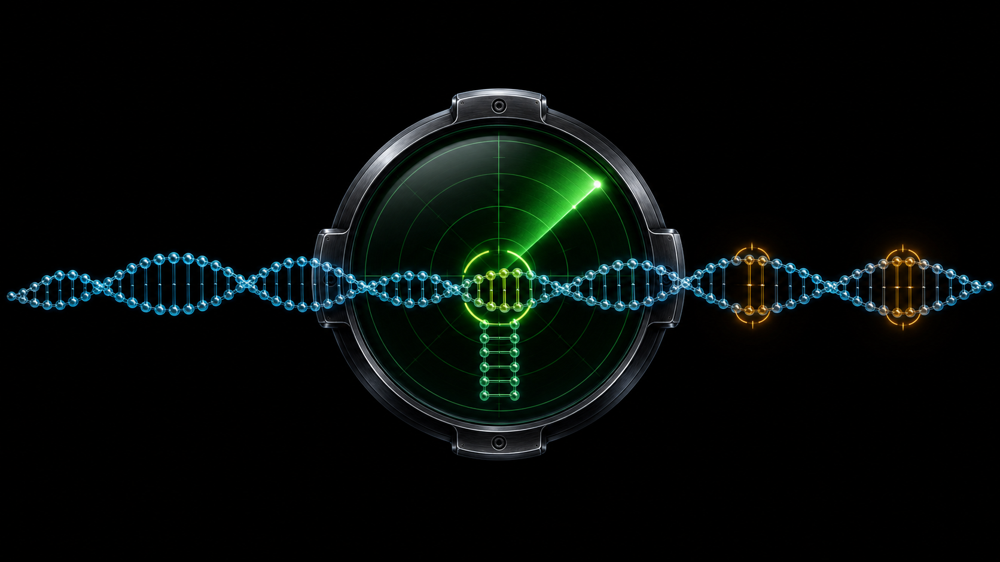
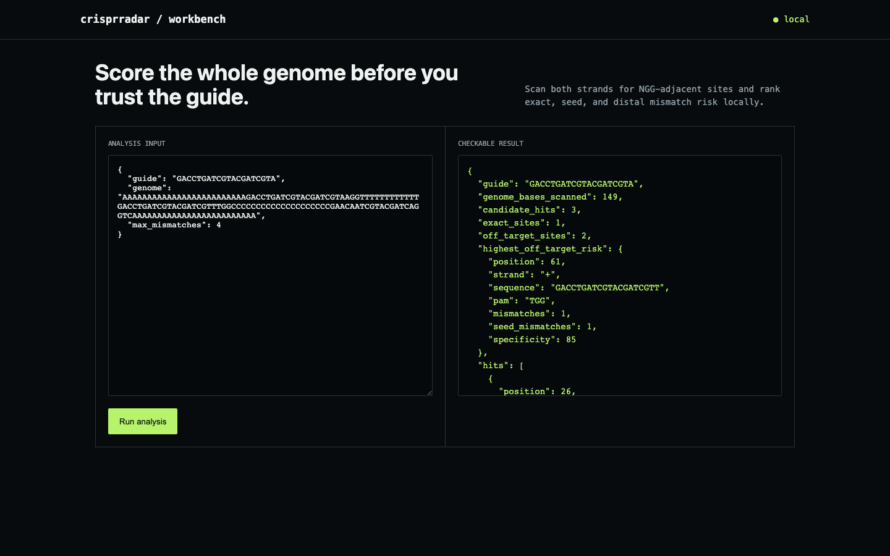

# crisprradar

[](https://github.com/ahmeddoghri/crisprradar/actions/workflows/tests.yml) [](https://adoghri.com/project-47.html)

**A CRISPR guide can be perfect on-target and still cut somewhere you didn't ask it to.**



Cas9 doesn't require an exact match to cut — a guide RNA with a couple of mismatches, especially outside the PAM-proximal seed region, can still find a site and cleave it. That's an off-target edit nobody designed for. crisprradar scans both strands of a sequence for every NGG-adjacent candidate, not just the intended one, and ranks them by exactly where the mismatches fall, because a mismatch in the seed is a very different risk than a mismatch eight bases out.



## How it works

Walk both strands of the input sequence looking for NGG PAM sites, extract each 20-nucleotide protospacer candidate, and score it against the intended guide by mismatch count and position. A mismatch in the PAM-proximal 8-base seed carries an extra penalty on top of the flat per-mismatch cost, because that's the region where Cas9 is least tolerant of errors and a distal-only mismatch is far more likely to still cut.

## What ships

- Both-strand NGG PAM scanning over a supplied sequence
- Seed-vs-distal mismatch weighting, not a flat edit-distance count
- Specificity scoring per candidate site, ranked worst-first
- CLI, JSON API, browser workbench, Docker, tests

## Run it end to end

```bash
python -m venv .venv && source .venv/bin/activate
python -m pip install -e .
crisprradar demo
crisprradar serve
```

Open <http://127.0.0.1:8090>. Analyze your own JSON input with `crisprradar analyze input.json`.

## API

- `GET /api/demo` returns the committed fixture and result.
- `POST /api/analyze` runs the same engine on a JSON body.

## The result

Across 149 bases on both strands, the scanner finds the one exact intended site plus two NGG-adjacent off-targets it wouldn't have caught with a single-strand or exact-match-only search. The worst of the two carries one seed mismatch and scores a specificity of 85 — high enough to actually flag for redesign, not just note and forget.

## Update: added a bound on max_mismatches

`analyze()` accepted any `max_mismatches` value with no validation. A
uniform-random 20nt sequence matches a fixed guide by chance at roughly
15 of 20 positions (P(match) = 1/4 per base), so a threshold anywhere
near that noise floor turns "scan for off-targets" into "list every NGG
site in the genome" — every candidate passes regardless of any real
similarity to the guide, and the ranked specificity list stops meaning
anything. Verified directly: on a random 4,000-base sequence, raising the
threshold toward the noise floor balloons the candidate count with sites
that share almost nothing with the guide.

`max_mismatches` is now bounded to 0–8, a generous but scientifically
defensible ceiling — SpCas9 off-target activity is not meaningfully
reported past a handful of mismatches in the literature this tool is
modeled on, and the bundled demo's own `max_mismatches: 4` sits
comfortably inside it. `tests/test_max_mismatches_bound.py` covers the
rejection of out-of-range values and the degenerate-output behavior the
bound prevents. (The core PAM-scanning and mismatch-scoring logic was
also property-tested against an independent brute-force implementation
across 500 randomized sequences and found no discrepancies — that part
was already correct.)

## Scope

This is a transparent, mismatch-only SpCas9/NGG scanner sized for a single sequence or test fixture, not a genome-scale indexed search like CRISPRitz or Cas-OFFinder. DNA/RNA bulges, chromatin accessibility, allele-specific effects, and wet-lab validation are real parts of guide design this intentionally doesn't claim.

## Test

```bash
python -m unittest discover -s tests -v
```

## Research basis

- [CRISPRitz](https://github.com/pinellolab/CRISPRitz)

MIT licensed.
